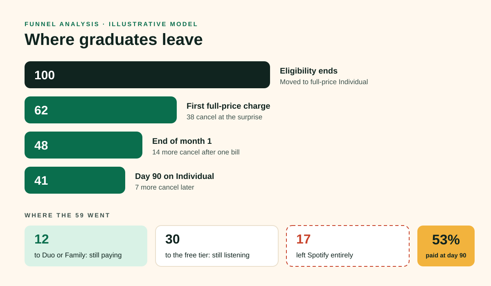
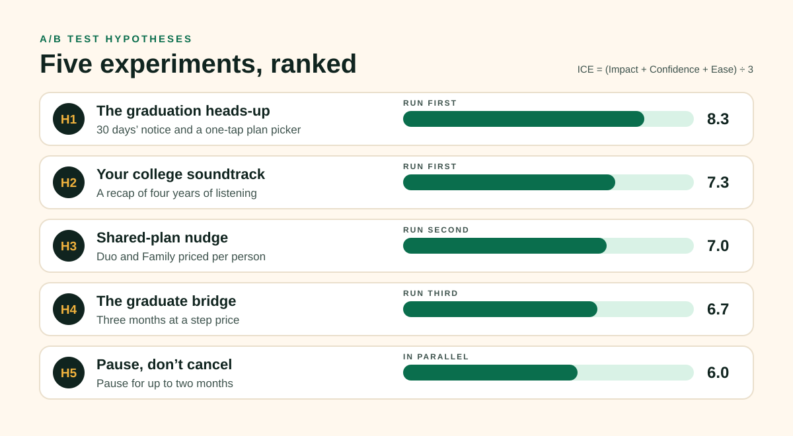
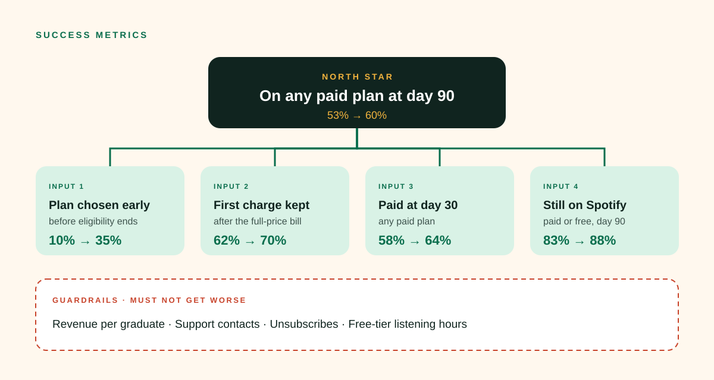

# Spotify "Graduation Day": Growth Concept 🎓

<kbd>
    
</kbd>

## Project Description 🎨

A growth concept for Spotify aimed at its most predictable churn moment: **graduation**. When Premium Student subscribers can no longer verify as students, they move to full-price Premium, which costs roughly twice as much, in the same months they move cities and start first jobs. This concept models the graduation funnel to find where people leave, designs five A/B tests ranked by ICE score to close those leaks, and defines a North Star (graduates on any paid plan at day 90), input metrics and guardrails to judge them. It is one of Chris Williams's [Product Marketing Concepts](https://allsar2k.github.io/pmm-portfolio/concepts/).

**[View the concept site →](https://allsar2k.github.io/spotify-growth-concept/)**

## Screenshots:

    <kbd></kbd>
    <kbd></kbd>
    <kbd></kbd>

## Technologies Used 💻

### Frameworks
- [x] **Cohort funnel analysis** — follow one graduating cohort for 90 days
- [x] **Hypothesis format** — if / then / because, with primary metric and guardrail
- [x] **ICE prioritisation** — impact, confidence and ease, scored 1–10
- [x] **North Star metric tree** — one outcome, four inputs, four guardrails
- [x] **Experiment design** — user-level randomisation, permanent holdout, full-season cohorts

### APIs & Web Services
- [x] **GitHub Pages** — hosts the one-page concept site
- [x] **GitHub Actions** — checks the design system's colour contrast on every push

### Data Sources
- [x] **Spotify Q3 2025 results** — subscriber and user totals
- [x] **Spotify Premium Student terms** — how the plan ends
- [x] **Illustrative model** — every funnel number is a labelled assumption, ready to be replaced with real data

## Architecture 🏗️

- **Pattern**: problem → funnel → experiments → metrics, each document feeding the next
- **Design system**: [Cap & Gown](docs/DESIGN.md), with tokens in `assets/tokens.json` and contrast checked by `scripts/check-contrast.mjs`
- **Graphics**: hand-written SVG with titles and descriptions
- **Site**: one static HTML page and one stylesheet, no JavaScript and no tracking
- **Target**: any modern browser; WCAG 2.2 AA

## Features 🌟

- 🎓 **[Problem and opportunity](docs/01-problem-and-opportunity.md)** — why graduation is the moment to win
- 🔻 **[Funnel analysis](docs/02-funnel-analysis.md)** — where graduates leave and where they go
- 🧪 **[A/B test hypotheses](docs/03-ab-test-hypotheses.md)** — heads-up, college soundtrack, shared plans, bridge price, pause
- 📈 **[Success metrics](docs/04-success-metrics.md)** — North Star, inputs, guardrails and dashboard
- 🎨 **[Design system](docs/DESIGN.md)** — Cap & Gown palette, type and motif

## Contributing ⚙️

Have a better hypothesis or real-world data to test the model against? Open an issue or fork the repository and send a pull request. Run `node scripts/check-contrast.mjs` before proposing colour changes.

## License 🪪

Site code is MIT licensed. Strategy documents and graphics © Chris Williams; see [LICENSE](LICENSE). This is an independent concept and is not affiliated with or endorsed by Spotify.

