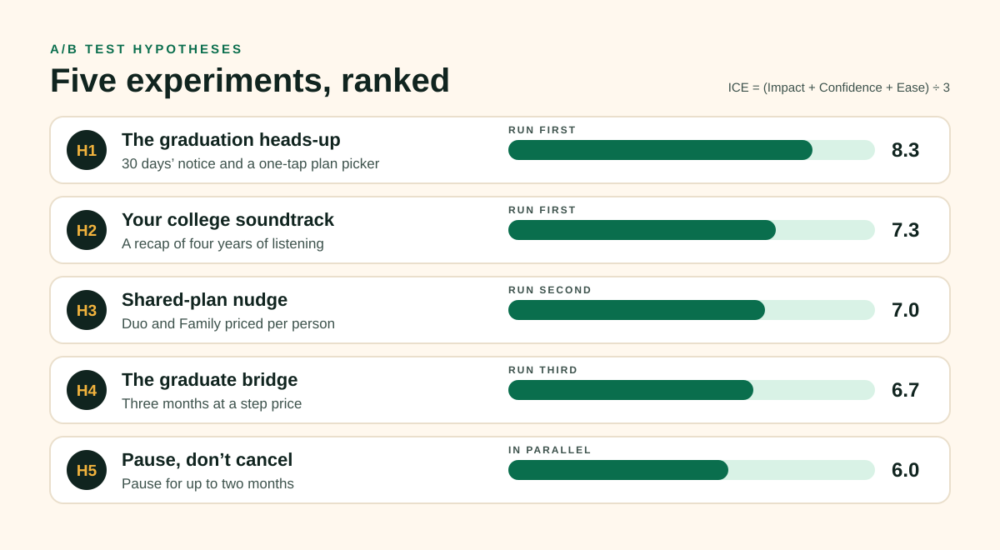

# 03 · A/B test hypotheses

Five experiments, each aimed at a leak found in [02 · Funnel analysis](02-funnel-analysis.md), ranked with ICE (Impact, Confidence, Ease, each 1–10).

## Experiment design for all five

- **Unit:** subscriber, randomised when they're 45 days from the end of student eligibility.
- **Control:** today's experience.
- **Holdout:** a permanent 5% that gets none of the changes, to measure the combined effect.
- **Primary metric:** on any paid plan at day 90 (the North Star).
- **Guardrails:** revenue per graduate at day 90, support contacts, complaints, and free-tier listening hours (so we don't trade paid users for silent ones).
- **Run length:** full graduation cohorts (May–June is the biggest), so seasonality doesn't fake a result.

## H1 · The graduation heads-up · ICE 8.3 (I 8, C 8, E 9)

**If** we tell students 30 days before eligibility ends what will change, what it will cost and what their options are (Individual, Duo, Family, or free), **then** fewer will cancel at the first full-price charge, **because** the biggest drop in the funnel happens at the moment of surprise.

- **Variant:** in-app message and email at day −30, reminder at day −7, with a one-tap plan picker.
- **Leading metric:** share who choose a plan before the end date.

## H2 · Your college soundtrack · ICE 7.3 (I 7, C 7, E 8)

**If** graduates get a Wrapped-style recap of their years on Spotify at graduation, with the songs that defined each year, **then** more will stay on Spotify at all, **because** a personal history raises the cost of switching in a way no competitor bundle can match.

- **Variant:** shareable "College Soundtrack" story in the app, sent with the heads-up.
- **Leading metric:** share rate; "left Spotify entirely" rate.

## H3 · Shared-plan nudge · ICE 7.0 (I 7, C 6, E 8)

**If** we show graduates what Duo and Family cost per person, **then** more will move to a shared plan instead of dropping to free, **because** many graduates move in with partners or friends and don't know a shared plan is cheaper per head.

- **Variant:** plan picker leads with per-person price; "invite someone" built in.
- **Guardrail:** revenue cannibalisation from users who would have paid for Individual.

## H4 · The graduate bridge · ICE 6.7 (I 9, C 5, E 6)

**If** graduates pay a step price for three months between Student and Individual, **then** more will reach day 90 still paying, **because** a gradual increase is easier to accept than an overnight doubling, during months when first salaries haven't arrived.

- **Variant:** three months at a price midway between Student and Individual, then full price.
- **Guardrail:** revenue per graduate at day 180. The bridge must pay for itself.
- **Risk:** it trains people to wait for discounts. Limit it to one bridge per account.

## H5 · Pause, don't cancel · ICE 6.0 (I 6, C 5, E 7)

**If** graduates who try to cancel can pause Premium for up to two months instead, **then** more will come back as paying users, **because** the gap between graduating and the first paycheque is temporary.

- **Variant:** "Pause for 1 or 2 months" on the cancellation screen, keeping downloads and playlists ready.
- **Leading metric:** share of pausers who resume.

## Order of play

1. **H1 and H2 together** (independent cells, factorial design): cheap, fast, aimed at the biggest leak.
2. **H3** once the plan picker from H1 exists.
3. **H4** only if H1–H3 leave a large price-driven drop, because it's the most expensive.
4. **H5** in parallel on the cancellation flow.
