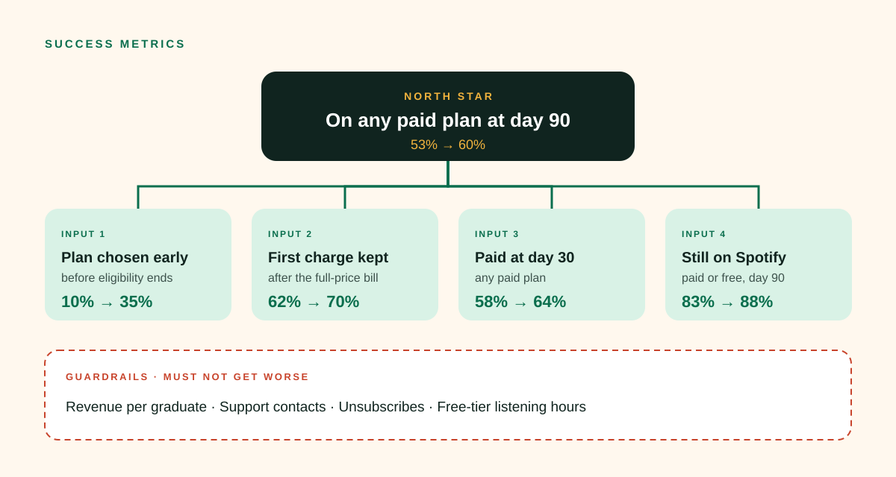

# 04 · Success metrics

## North Star

**Graduate paid retention at day 90:** the share of Student subscribers who are on any paid Spotify plan (Individual, Duo, Family) 90 days after their student eligibility ends.

- **Why this one:** it's tied to revenue, it's measured per cohort, and it counts shared plans as success. It rewards keeping listeners paying, not forcing everyone onto Individual.
- **Model baseline:** 53% ([02 · Funnel analysis](02-funnel-analysis.md)). **Concept target:** 60% within a year, from H1–H3.

## Input metrics (what the team can move week to week)

| Input | Definition | Moved by | Model baseline → target |
|---|---|---|---|
| Plan chosen early | Share who pick a plan before eligibility ends | H1 heads-up, H3 shared plans | 10% → 35% |
| First charge kept | Share still subscribed after the first full-price charge | H1, H4 bridge | 62% → 70% |
| Day-30 paid | Share on any paid plan at day 30 | H3, H4, H5 pause | 58% → 64% |
| Stayed on Spotify | Share still active, paid or free, at day 90 | H2 soundtrack | 83% → 88% |

## Guardrails (must not get worse)

| Guardrail | Why it's here |
|---|---|
| Revenue per graduate at day 90 and day 180 | Discounts and shared plans can raise retention while lowering revenue. |
| Support contacts per 1,000 graduates | Confusing plan changes show up here first. |
| Unsubscribes from email and push | The heads-up must help, not nag. |
| Free-tier listening hours | Moving people to free shouldn't come at the cost of them listening less. |

## Reading results

- **Decide on the North Star; diagnose with the inputs.** A test that lifts "plan chosen early" but not day-90 paid retention changed behaviour without changing the outcome.
- **Minimum detectable effect:** plan for a 2-point lift in the North Star. Graduating cohorts are large enough to detect this within one season.
- **Report by segment:** 1-year vs. 4-year Student tenure, country, and heavy vs. light listeners. A win that only works for heavy listeners is a smaller win than it looks.

## Dashboard (weekly, during graduation season)

1. North Star by cohort month, test vs. control vs. holdout
2. Funnel chart from eligibility end to day 90
3. Destination split: Individual / Duo / Family / Free / left
4. Guardrails, with alerts if any moves more than 5% against control

All baselines and targets are illustrative planning assumptions.
